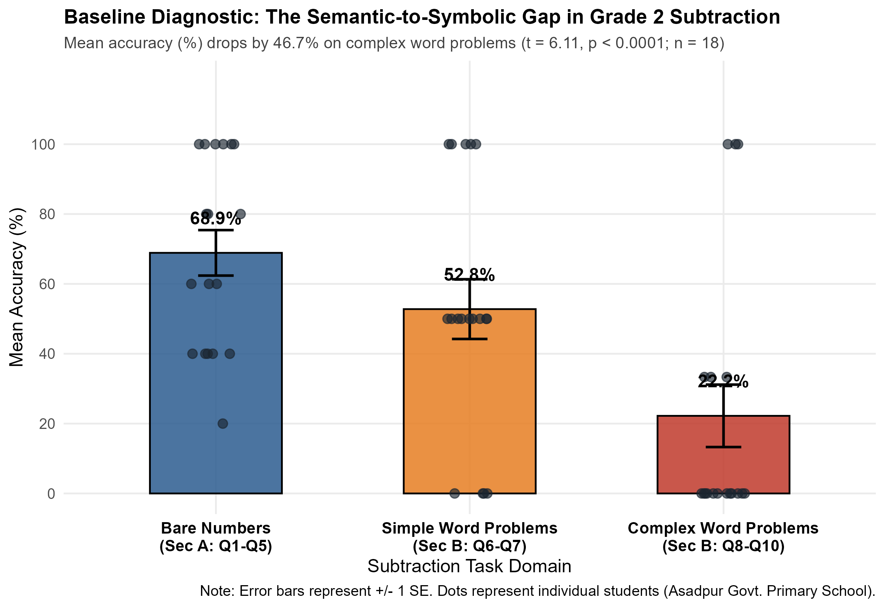

# Generative AI as a Visual Scaffold: Decoding Complex Subtraction Word Problems in Early Primary Classrooms 🇧🇩

*A quasi-experimental field study evaluating Generative AI as a visual scaffold for decoding complex subtraction word problems in Grade 2 classrooms in rural Bangladesh. Includes baseline diagnostics, behavioral protocol, and R pipeline.*

---

> **📌 Current Project Status (November 2026):** 
> *  **Phase 1: Study Design & Baseline Diagnostics** - *Completed*
> *  **Phase 2: 8-Day Classroom AI-Visual Intervention** - *In Progress*
> *  **Phase 3: Post-Test Assessment & R Statistical Modeling** - *Scheduled*

---

### 1. Overview & Problem Statement
In rural primary classrooms in the Haor region of Bangladesh (Khaliajuri, Netrokona), early grade learners often struggle to transition from mechanical calculation to solving mathematical word problems. Without visual context, young learners experience high cognitive load when trying to translate text into mathematical operations. 

This study evaluates whether culturally contextualized, **Generative AI-assisted visual scaffolding** can bridge this semantic-to-symbolic gap and improve conceptual subtraction skills among Grade 2 students ($N = 20$).

### 2. Key Baseline Diagnostic Findings (Pre-Test)
Prior to the intervention, a 10-item diagnostic baseline assessment was administered, divided into **Section A** (5 bare-number procedural items) and **Section B** (5 word problems of varying semantic complexity).
* **High Procedural Fluency:** The vast majority of participating students demonstrated strong mastery in Section A (direct numerical subtraction, including regrouping/borrowing).
* **The Semantic Bottleneck (High Omission Rate):** A critical cognitive bottleneck emerged in Section B. Most students left **Items 8, 9, and 10** completely blank (omission errors) or defaulted to addition. These items involved:
  1. **Comparison structures** (*"How many more/less?"* - Item 8)
  2. **Part-Whole remaining quantities** (Item 9)
  3. **Missing subtrahends** ($a - ? = b$ - Item 10)

### 3. Targeted 8-Day GenAI Visual Intervention
To directly address the baseline diagnostic gaps, an 8-day classroom intervention was designed using AI-generated visual story slides tailored to the local rural context (e.g., boats, fish, mangoes):
* **Days 1-3 (Comparison Module):** Side-by-side one-to-one visual matching to resolve confusion around the relational term *"more"* in subtraction.
* **Days 4-5 (Part-Whole Module):** Visual bar/path progression to conceptualize remaining quantities.
* **Days 6-8 (Missing Subtrahend Mystery):** Narrative visual detective stories to deduce unknown subtracted quantities.

### 4. Variables & Data Architecture (20-Variable Codebook)
The study tracks both cognitive outcomes and in-class behavioral processes across three phases:
* **Baseline & Controls:** `Student_ID`, `Gender`, `Baseline_Math_Grade`
* **Cognitive Metrics (Pre & Post):** `SecA_Score` (0-5), `SecB_Simple` (0-2), `SecB_Complex` (0-3), `Total_Score` (0-10), `Blank_Count` (omission tracking), `Add_Confusion` (operation error tracking).
* **8-Day Behavioral Process Metrics:** 
  * `Int_Attendance` (Dosage effect: 0–8 days)
  * `Active_Participation` (Tally of voluntary responses)
  * `Peer_Discussion` (Binary: `1` = Yes, `0` = No)
  * `Scaffolding_Need` (Ordinal: `1` = Low, `2` = Medium, `3` = High teacher support required)
  * `Enjoyment_Rating` (3-point Smiley Face Likert scale)

### 5. Planned Statistical Analysis in R
Post-intervention data will be analyzed in **R** (`tidyverse`, `gtsummary`, `ggplot2`) using:
1. **Paired t-test / Wilcoxon Signed-Rank Test:** Evaluating pre-to-post gains in `SecB_Complex` scores and reductions in `Blank_Count`.
2. **Multiple Linear Regression:** Modeling total score improvement as a function of intervention attendance (dosage), active participation, and scaffolding needs.
3. **Logistic Regression:** Assessing predictors of peer discussion and classroom engagement.

---
**Principal Investigator:** E. M. Noman  
*Assistant Teacher, Asadpur Government Primary School, Khaliajuri, Netrokona, Bangladesh*
